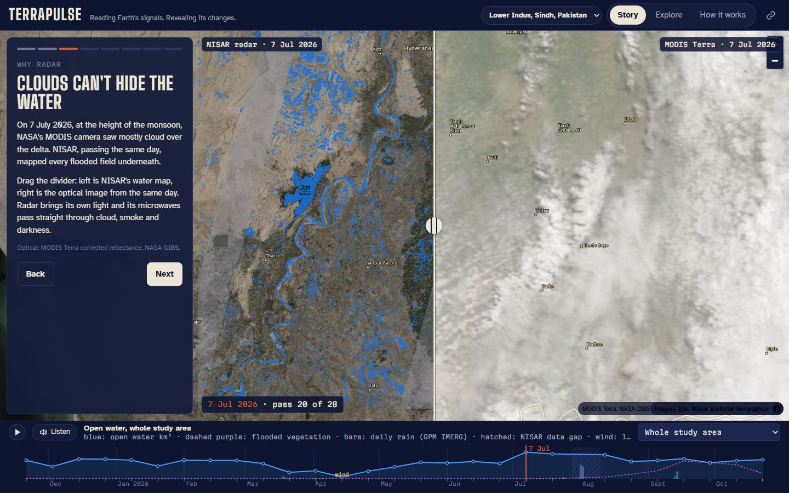
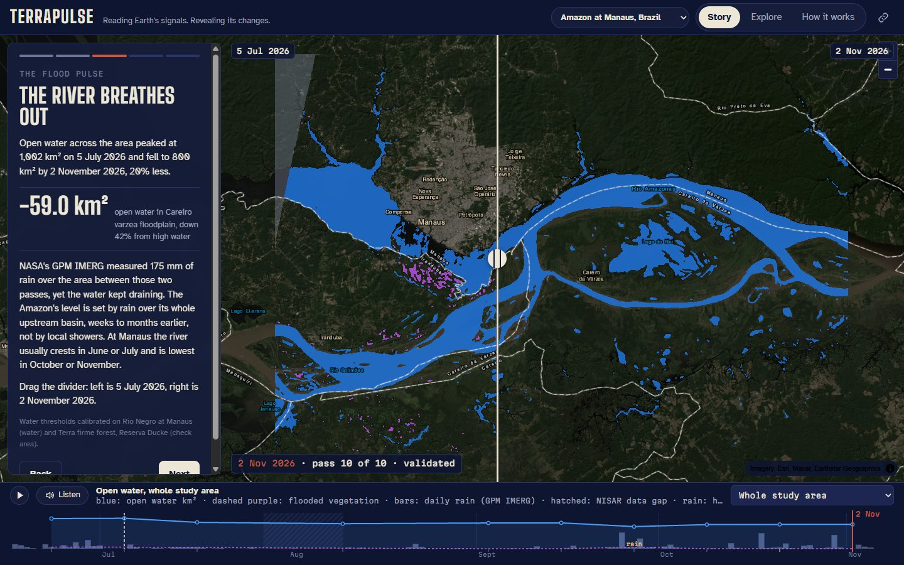

# TerraPulse

**Reading Earth's signals. Revealing its changes.**

TerraPulse turns NISAR L-band radar into a living map of how land and water change through the seasons: floods arriving and draining, wetlands swelling and shrinking, crops growing and being harvested. It covers a full year of the lower Indus in Sindh, Pakistan, the Amazon flood pulse at Manaus, Brazil, and lets anyone browse NISAR imagery anywhere on Earth.

Built by team **TERRAPULSE** (Sudais Khalid, Sunnia Aslam, Topi, Pakistan) for the 2026 NASA Space Apps Challenge, challenge *Dancing with the SARs*.



**Live app:** `web/index.html` (deployed to GitHub Pages) · **Slides:** `web/slides.html` · **Submission text:** [docs/SUBMISSION.md](docs/SUBMISSION.md)

## What you can do

- **Story**: short chapters for each site, with every number computed from the data when the page loads.
- **Explore**: seven layers, 28 passes for the Indus and 10 for Manaus, a swipe divider to compare two passes or radar against the optical image of the same day (MODIS or HLS).
- **Pulse strip**: open water and flooded vegetation for every pass against daily GPM IMERG rainfall, for the whole area or one place, with wind-roughened and rain-affected passes flagged. Press play, or **Listen** to hear the year as sound.
- **Tools**: click any spot for its radar history, drag a box to measure any area across all passes, download CSV, and see automatically detected notable changes.
- **Anywhere on Earth**: NASA GIBS NISAR mosaics, plus the dates NISAR imaged any point (ASF Search API).
- **Shareable links** that reproduce any view.

## Layers

| Layer | What it shows | How it is made |
|---|---|---|
| Radar colour | HH (red, blue) and HV (green) backscatter per pass | NISAR GCOV gamma-naught, 100 m |
| Water and flooded vegetation | Open water, and water under crops or reeds | HH and HV thresholds calibrated on Keenjhar Lake vs desert, per radar mode, plus a 3 dB darkening rule; L-band double bounce rule |
| What changed | New water, receding water, brighter HH, vegetation gain or loss | Log ratio between any two passes, computed in the browser |
| How often under water | Share of passes with open water | Per-pixel frequency |
| Surface rhythm | Places grouped by how their signal moved through the year | k-means on yearly statistics, named by physical rules |
| Vegetation swing | Range of HV over the year | 95th minus 5th percentile |

## Data

- **NISAR L2 GCOV** (NASA/JPL-Caltech and ISRO), from the ASF DAAC.
  - Lower Indus: track 164, frame 76, descending. 27 passes from one processing version (PROVISIONAL, CRID P05023), 21 Nov 2025 to 11 Oct 2026, plus the VALIDATED pass of 23 Oct 2026.
  - Amazon at Manaus: track 140, frame 90, descending. 10 passes, 23 Jun to 2 Nov 2026, one radar mode.
- **GPM IMERG** Late Run daily V07 (GES DISC) for rainfall per zone; **NASA POWER** as a fallback.
- **NASA GIBS**: NISAR worldwide mosaics, MODIS Terra true colour and Harmonized Landsat Sentinel-2 for the optical comparison.
- **ASF Search API** for finding NISAR passes anywhere.
- **Esri World Imagery** and reference labels as the basemap.

## Method in brief

1. Search ASF for GCOV over the site and keep one product per date from a single CRID, so changes are not artefacts of software updates.
2. Stream only the study area out of each 6 GB HDF5 file: read the chunk index once, fetch the compressed chunks with parallel HTTP range requests, decode deflate and shuffle, and check the decoder against h5py.
3. Drop samples the NISAR mask flags as invalid (swath gaps), average 10 m and 20 m pixels onto one 100 m UTM grid (also reduces speckle), and check for brightness bias between radar modes on stable targets.
4. Classify open water with HH and HV thresholds chosen per radar mode to best separate Keenjhar Lake (water) from the Jhimpir desert (dry land), plus newly flooded ground that turns 3 dB darker than its own median; flag passes where wind roughened the lake, or where GPM IMERG shows at least 15 mm of rain in the three days before (wet canopies mimic flooding). Classify likely flooded vegetation (HH at least 3 dB above the pixel's own median and rising more than HV), and compute frequency, change and clustering products.
5. Reproject to Web Mercator and write small 8-bit PNG layers and a manifest that the web app decodes and colours in the browser.

Limits are listed in the app under *How it works*: wind-roughened water, wet soil versus flooded vegetation, radio interference, the 27 July to 10 August 2026 NISAR data gap, coarse rainfall, PROVISIONAL maturity.

## Results at a glance

### Lower Indus (28 passes, 21 Nov 2025 to 23 Oct 2026)

- Keenjhar Lake reads 88 to 104 km² of open water on 24 of 28 passes (median 92 km²). It reads 75 to 80 km² on 21 March, 2 April and 26 April, when part of its surface was roughened, and 11 km² on 14 April, which is flagged as wind-roughened (only 13% of the lake looked like water).
- Haleji Lake, not used for calibration, reads 14.5 to 18.4 km² on 9 of the 11 passes that fully cover it.
- The 40 MHz radar mode reads dark surfaces about 1 dB brighter than the 20 MHz mode, so water thresholds are calibrated per mode.
- Rice season on the left bank of the Indus: open water peaks on 7 July (fields flooded for transplanting), likely flooded vegetation peaks at 1,218 km² across the study area on 17 September, then falls with the harvest.
- Water in the Badin coastal lagoons grew by about 62 km² between 19 July and 12 August, across the early August monsoon rain.
- GPM IMERG measured 69 mm of rain over the study area between the 19 July and 12 August passes, 61 mm of it on 1 and 2 August.
- Known limit: 12 to 17% of desert pixels in the check area pass the water test.

### Amazon at Manaus (10 passes, 23 Jun to 2 Nov 2026)



- Water thresholds calibrated on the Rio Negro against Reserva Ducke rainforest: HH < -14.0 dB and HV < -20.0 dB, 88% hit rate on the river, 0% false alarms in the forest.
- Open water fell 20%, from 1,002 km² on 5 July to 800 km² on 2 November, as the river fell toward low water. The Careiro várzea lost 42% of its open water; likely flooded forest fell from about 50 km² to almost none.
- 175 mm of local rain fell over the same period (GPM IMERG): the flood pulse is set by the whole upstream basin, not local showers.
- 27 September is flagged as rain-affected (24 mm in three days): a wet canopy briefly mimicked flooded forest. Passes with at least 15 mm of rain in the three days before are flagged automatically.
- On 2 November MODIS saw 96% cloud and haze over the area while NISAR mapped the rivers and lakes.

## Run it

```bash
python -m venv .venv
.venv/bin/pip install -r requirements.txt        # Windows: .venv\Scripts\pip
echo "EARTHDATA_TOKEN=<your token>" > .env         # from https://urs.earthdata.nasa.gov/profile
python -m terrapulse search  --site lower-indus  # or amazon-manaus
python -m terrapulse ingest  --site lower-indus --workers 8   # resumable; slow links: use Colab
python -m terrapulse rain    --site all          # GPM IMERG (approve "NASA GESDISC DATA ARCHIVE" in Earthdata Login)
python -m terrapulse process --site lower-indus  # writes web/data/lower-indus and web/data/sites.json
python -m http.server -d web 8000                # open http://localhost:8000
```

On a slow connection, run `notebooks/terrapulse_pipeline.ipynb` in Google Colab: it contains the whole pipeline, runs it at cloud speed and downloads one results zip. Rebuild the notebook after changing the package with `python tools/build_notebook.py`.

Adding a site: add a `Site` to `terrapulse/config.py` with its NISAR track and frame, a few named zones, one permanent water body (`water_ref`) and one never-flooded area (`dry_ref`), then run the stages above.

Deploying: push to GitHub and set *Settings > Pages > Source* to *GitHub Actions*; `.github/workflows/pages.yml` publishes `web/`.

## Repository

```text
terrapulse/   Python pipeline (search, ingest, products, export, rainfall)
notebooks/    Self-contained Colab notebook that runs the pipeline
tools/        Notebook builder
web/          Static web app (MapLibre GL JS) and slide deck, deployed to GitHub Pages
docs/         Plan, data notes, submission text, demo video script and subtitles
```

## Use of AI

Code, documentation and copy in this project were drafted with the help of an AI coding assistant (Claude, by Anthropic) under the team's direction, then reviewed, tested and edited by the team. The scientific approach, study area, data choices and story are the team's own. No AI-generated images, video or audio are used.

## License

Apache License 2.0. See [LICENSE](LICENSE).
