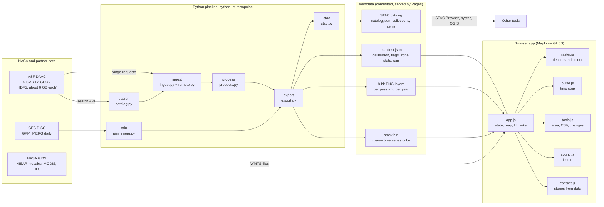

# Architecture

TerraPulse has two halves that meet at a small, documented data contract:

- a **Python pipeline** (`terrapulse/`) that streams NISAR radar, turns it into science layers and writes them as compact web files;
- a **static web app** (`web/`) that decodes and colours those files in the browser.

There is no server, database or tile service. Everything is static files on GitHub Pages, so the app is free to host, fast and easy to reproduce.

## Pipeline stages

| Stage | Module | What it does | Key decisions |
|---|---|---|---|
| `search` | `catalog.py` | Queries ASF for GCOV over the site's track and frame and keeps **one product per date**. | The core series uses the most common PROVISIONAL processing version (CRID), so changes are not artefacts of software updates. VALIDATED products are kept and labelled; BETA is dropped. |
| `ingest` | `ingest.py`, `remote.py` | Streams **only the study area** out of each HDF5 file. Reads the chunk index once, merges nearby chunks into large HTTP range requests, fetches them in parallel, then decodes deflate, shuffle and Fletcher-32 in NumPy. | Only the needed layers (HH, HV and the validity mask) inside the study area are downloaded, never the whole file. No GDAL. The decoder is tested byte for byte against h5py (`tests/test_remote.py`). Invalid samples (NISAR mask) are dropped before averaging to a common 100 m UTM grid, which also reduces speckle. Resumable per date. |
| `rain` | `rain_imerg.py` | Daily GPM IMERG Late V07, area mean per zone. | NASA POWER is the fallback when IMERG is not available. |
| `process` | `products.py` | Water thresholds, flooded vegetation, frequency, change, yearly statistics, k-means rhythm classes. | Thresholds are chosen **per radar mode** by maximising Youden's J between a permanent water body and never-flooded land. Clusters are named by physical rules, not by hand. |
| `export` | `export.py` | Reprojects to Web Mercator, quantises to 8 bits, writes PNGs, the stack and the manifest; flags wind-roughened and rain-affected passes. | dB is stored as `q = 1 + round((dB + 35) / step)` with `q = 0` as no data, so each pass becomes 0.7 to 2 MB of PNGs for the browser. |
| `stac` | `stac.py` | Publishes every layer as a STAC 1.1.0 catalog. | The raster extension records `scale` and `offset`, so any tool can recover dB. Each item links to its source granule. |

## Data contract

`web/data/<site>/manifest.json` is the single source of truth for the app. Its main parts:

- `image`: width, height and corner coordinates of every PNG (all layers share one grid);
- `db_quant`: how to decode grey PNGs back to dB;
- `dates[]`: one entry per pass with maturity, CRID, radar mode, thresholds used, `wind_roughened`, `rain_3d_mm`, `rain_affected`;
- `zones`: per-zone open water and flooded vegetation in km² for every pass;
- `params`: calibration results (hit rates, false alarms, mode bias) and rule definitions;
- `rain`: daily rainfall series with its source and caveat.

`tests/test_web_data.py` checks this contract on every push: every pass has its three PNGs, every layer matches the manifest grid, the stack has the right size, and each zone has one value per pass.

## Web app

- **No build step.** Native ES modules, MapLibre GL JS from a pinned CDN version, no framework.
- **Pixels are decoded on the client.** `raster.js` turns grey PNGs into dB and colours them with the current threshold or ramp, so the water threshold slider and the change map update instantly, without new downloads.
- **Stories are computed, not written.** `content.js` builds every number in the stories from the manifest when the page loads, so the text cannot drift from the data.
- **Every view is a link.** The URL hash stores site, mode, layer, dates, zone and camera.
- **Quality flags travel with the data.** Wind-roughened and rain-affected passes are marked in the time strip, menus, area tool and CSV, and are left out of peaks and notable changes.

## Testing and CI

`.github/workflows/ci.yml` runs ruff, then pytest on Python 3.10 to 3.13 (unit tests, decoder against h5py, data contract, notebook sync and STAC schema validation), then a JavaScript syntax check and JSON check of all published data. `.github/workflows/pages.yml` deploys `web/` to GitHub Pages on every push to `main`.

## Reproducibility

- The Colab notebook embeds the exact package source; `tests/test_notebook.py` fails if it falls out of date.
- One processing version per series and the per-pass thresholds are recorded in the manifest and in each STAC item.
- The Earthdata token is read from `.env` or a hidden prompt and never written anywhere.
